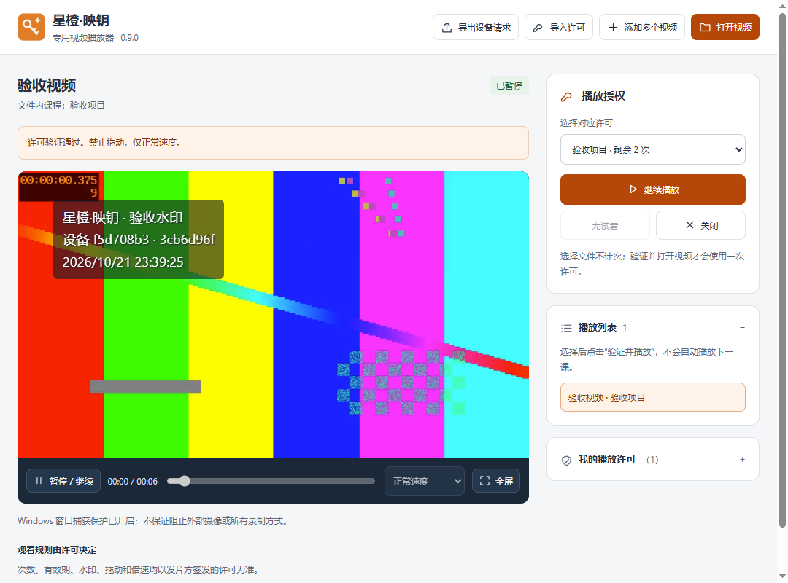
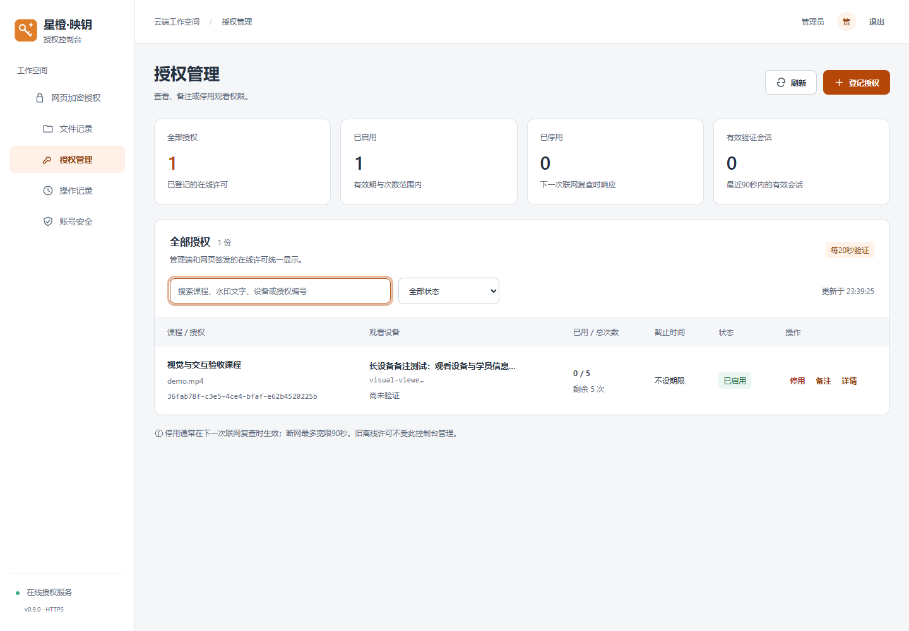

# 星橙·映钥 YingKey

Windows 视频加密、设备绑定授权与专用播放系统，包含桌面管理端、独立播放器和网页授权控制台。当前发布版本：**v0.9.0**。

## 下载：按你的角色选择

请在 [v0.9.0 发布页](https://github.com/xiandan-superman/xingcheng-yingkey/releases/tag/v0.9.0) 下载完整压缩包并解压。Windows 10/11，64位。

| 使用角色 | 下载 | 包含什么 |
|---|---|---|
| 产品设计、开发和维护人员 | [产品设计方包](https://github.com/xiandan-superman/xingcheng-yingkey/releases/download/v0.9.0/yingkey-v0.9.0-designer-win-x64.zip) | 源码、无真实数据的服务维护材料、Node运行时、界面预览与说明 |
| 视频提供方、加密和授权操作人员 | [视频加密使用方包](https://github.com/xiandan-superman/xingcheng-yingkey/releases/download/v0.9.0/yingkey-v0.9.0-encryptor-win-x64.zip) | 完整桌面管理端、加密与授权操作指南 |
| 学员或观看者 | [观看方包](https://github.com/xiandan-superman/xingcheng-yingkey/releases/download/v0.9.0/yingkey-v0.9.0-viewer-win-x64.zip) | 完整独立播放器、观看指南 |

这些是交付角色分包，不是新增的后台权限角色。GitHub 自动生成的 Source code 下载仅包含仓库源码；普通使用者应下载上表的角色包。不要只复制exe，程序需要同目录的配套文件。

**下载包不含课程视频、播放许可、后台账号密码、服务连接文件、线上密钥或业务数据。** 观看方的视频和许可由视频提供方另行交付；加密操作方的后台账号与服务连接配置由所属管理员另行提供。公开下载不等于获得生产后台访问权限。

## 三端功能

- **桌面管理端**：单文件或批量加密、可选试看、课程分组、设备请求导入、次数/期限与播放策略设置、许可签发及在线记录上传。
- **独立播放器**：导出设备请求、导入设备许可、播放列表、在线播放验证、动态水印与受许可控制的拖动/倍速。
- **网页控制台**：浏览器本地加密、在线授权、文件与分组记录、授权停用/恢复、操作记录和成员权限管理。

## 标准交付流程

1. 观看方解压播放器，导出设备请求文件，交给视频提供方。
2. 视频提供方在管理端加密视频，导入设备请求，设置规则并签发许可。
3. 视频提供方把加密视频、对应许可和观看方包交给指定观看者。
4. 观看方导入许可，打开视频，点击“验证并播放”。在线许可须先完成服务端登记。

选择文件不计次；成功开启新播放计一次，同次暂停后继续不重复计次。视频结束后再次观看按许可计次。

## 界面预览

### 管理端


### 播放器


### 网页平台


## 开发与构建

建议在 Windows x64 使用 Node.js 24（本项目已验证 v24.19.0）。首次安装依赖及获取Electron构建资源需要联网。

```sh
npm ci
npm test
npm start
npm run package
```

打包采用 Electron 44.9.0，管理端附带 ffmpeg-static。当前构建脚本会在仓库的上一级目录输出两个桌面成品目录；`npm run package:player` 可仅构建播放器。源码不含node_modules和机器专用目录联接。

授权服务代码在 `server/`，Windows维护脚本与配置示例在 `deployment/`。部署布局和注意事项见 [服务维护说明](deployment/README.md)。桌面与网页加密均在使用方本地进行，服务保存授权及加密文件记录。

## 验证与产品边界

v0.9.0 已完成82项业务自动测试，另验证实际桌面安装包的加密、授权、计次、暂停继续、失败重试、到期与远程停用；网页验证包含多种窗口宽度、键盘焦点、减少动态效果及文件实际落盘。上线时补测了公网播放、批准后响应丢失的重试计次与远程停用。测试通过不代表覆盖所有硬件和网络环境。

- 在线播放约20秒复查；自最后一次成功验证起，断网宽限最多90秒。服务器需持续开机联网。
- 许可绑定设备与签发时的视频清单；旧版离线许可无法远程收回。
- Windows窗口捕获保护和水印无法保证阻止所有录制方式、摄像头或系统管理员级操作。
- 网页端不生成试看；需要试看请使用桌面管理端。
- 硬件兼容、长视频耐久性和生产长时间压测仍需根据实际环境验收。

## 说明与第三方材料

- [加密与授权指南](docs/先读我-加密与授权.txt)
- [观看指南](docs/先读我-如何观看.txt)
- [产品设计与维护指南](docs/先读我-产品设计与维护.txt)
- [产品背景](docs/PRODUCT.md) · [视觉规范](docs/DESIGN.md)

公开仓库不代表自动授予额外的开源许可，本仓库目前未附独立开源许可证。Electron/Chromium、FFmpeg、GSAP等第三方组件依各自许可证使用，成品包中保留相应版权与许可说明。GSAP采用其标准免费许可，说明保留在共享界面资源中。
