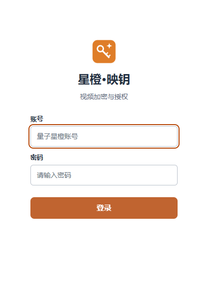
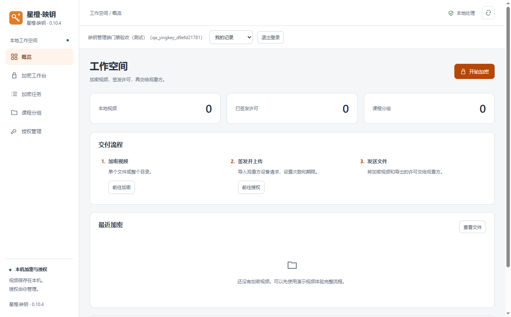

# 星橙·映钥 YingKey

面向公司员工的视频加密、设备授权与专用播放系统，包含 Windows 管理端、独立播放器和网页授权后台。

**桌面版本：v0.10.5 · 授权服务版本：v0.10.2**

## 下载

Windows 10/11，64 位。请下载完整角色包后解压，保留整个程序文件夹，不要只复制 exe。

| 使用角色 | 下载 | 内容 |
|---|---|---|
| 公司加密与授权员工 | [视频加密使用方](https://github.com/xiandan-superman/xingcheng-yingkey/releases/download/v0.10.5/yingkey-v0.10.5-encryptor-win-x64.zip) | 管理端与操作指南 |
| 学员或观看者 | [观看方](https://github.com/xiandan-superman/xingcheng-yingkey/releases/download/v0.10.5/yingkey-v0.10.5-viewer-win-x64.zip) | 独立播放器与观看指南 |
| 产品设计、开发与维护人员 | [产品设计方](https://github.com/xiandan-superman/xingcheng-yingkey/releases/download/v0.10.5/yingkey-v0.10.5-designer-win-x64.zip) | 源码、无业务数据的服务材料、Node 运行时、界面预览与说明 |

[完整发布页](https://github.com/xiandan-superman/xingcheng-yingkey/releases/tag/v0.10.5) · [SHA-256 校验文件](https://github.com/xiandan-superman/xingcheng-yingkey/releases/download/v0.10.5/SHA256SUMS.txt) · [更新记录](CHANGELOG.md)

GitHub 自动生成的 Source code 是源码，不是可直接运行的桌面程序。普通使用者请选择上面的角色包。升级前先关闭旧版，避免新旧程序同时写入同一份本机数据。

下载包不包含课程、观看许可、真实账号密码、平台接入密钥或生产业务数据。公开下载不等于获得公司后台访问权限。

## 登录与公司协作

管理端启动时验证已保存的员工登录；没有有效登录时，仅显示独立登录窗口。输入量子星橙账号与密码，点击“登录”后进入工作台，无需打开浏览器。退出或登录失效后返回独立登录窗口。



管理员在[量子星橙账号中心](https://account.qstarorange.com/)分配映钥平台访问：平台管理员拥有业务管理权限；普通成员需要 `operate` 操作权限才能使用管理端。只读成员在网页查看记录。账号中心管理员身份不会自动授予其他平台权限。

管理端不能使用旧账号或全局连接文件跳过登录，每次新业务操作都会验证身份与权限。密码只发送到账号中心，不保存到本机。停用、撤权或无法在线验证时，不允许开始新的业务操作；已有文件、密钥与历史记录保留。

同一家公司共享业务资料，员工可查看本人或公司记录。桌面只显示该电脑的本机资料，网页汇总已同步记录，不自动传输视频文件。旧记录人员未知时保持未知，不按同名账号自动合并；统一账号改名后仍按稳定身份编号记录归属。

## 三端功能

- **管理端**：单个或批量加密、可选试看、课程分组、设备请求导入、许可签发与导出、在线记录上传、加密任务及失败原因。
- **播放器**：设备请求导出、许可导入、播放列表、次数与期限校验、动态水印、受许可控制的拖动和倍速。观看方不需要员工账号。
- **网页后台**：浏览器本地加密、在线授权、公司文件与任务记录、停用与恢复、备注、删除与回收站。



## 使用流程

1. 观看方导出 `.vdevice` 设备请求，交给视频提供方。
2. 员工登录管理端，加密视频，导入设备请求并设置次数、期限和播放规则。
3. 签发许可；在线许可按提示完成后台登记，再交付 `.vdrm` 视频、`.vlicense` 许可和观看方包。
4. 观看方导入许可，打开视频，点击“验证并播放”。

选择文件不计次；成功开始新的播放计一次，同次暂停后继续不重复计次。任务同步、文件登记和授权登记分别显示，不会把“任务已同步”误报为“在线授权可用”。

## 删除与回收站

创建者或管理员可删除已结束任务及无未删除授权关联的文件记录。授权删除与恢复仅限管理员；删除同时停用在线授权。恢复授权后仍保持停用，次数不会清零。

删除后台文件记录不会删除电脑里的视频。已删除的授权不能通过重新上传或直接启用绕过回收站。空分组可删除；操作日志按现有规则保留最近 500 条，不开放手动删除。

详见[删除规则](docs/删除与回收站说明.md)。

## 开发与构建

已验证 Windows x64、Node.js 24.19.0、Electron 44.9.0。首次安装依赖和下载构建资源需要联网。

```sh
npm ci
npm test
npm start
npm run package
```

`npm run package:player` 仅构建播放器。构建脚本在源码的上一级输出桌面程序目录。仓库不包含 node_modules、运行时 exe 或机器专用目录联接。

账号中心是独立服务，本仓库提供映钥侧 OIDC 接入，不包含账号中心数据库或接入凭据。管理端默认信任公司服务地址；自建环境需由维护人员调整受信地址并重新构建。服务部署与配置见[维护说明](deployment/README.md)。

## 验证与边界

109 项自动测试通过。实际管理端安装包已验证独立窗口、键盘焦点、200% 缩放、登录取消、真实统一登录、加密、退出锁定、权限撤销及数据保留。播放器已完成实际计次、暂停继续、到期和远程停用回归；本版未修改其业务协议。

- 在线播放约 20 秒复查，自最后成功验证起断网宽限最多 90 秒；服务需持续在线。
- 许可绑定设备及签发时的视频清单；已分发的离线许可不能远程收回。
- 窗口捕获保护和水印无法保证阻止所有录制方式。
- 网页端不生成试看，需要试看请使用管理端。
- 长视频耐久性、全部硬件和复杂网络环境仍需按实际部署环境验收。

## 说明与第三方材料

[加密与授权指南](docs/先读我-加密与授权.txt) · [观看指南](docs/先读我-如何观看.txt) · [产品维护指南](docs/先读我-产品设计与维护.txt)

本仓库未附独立开源许可证，公开源码不自动授予额外许可。Electron/Chromium、FFmpeg、GSAP 等组件遵循各自许可证；相关版权和许可说明保留在源码及成品中。
